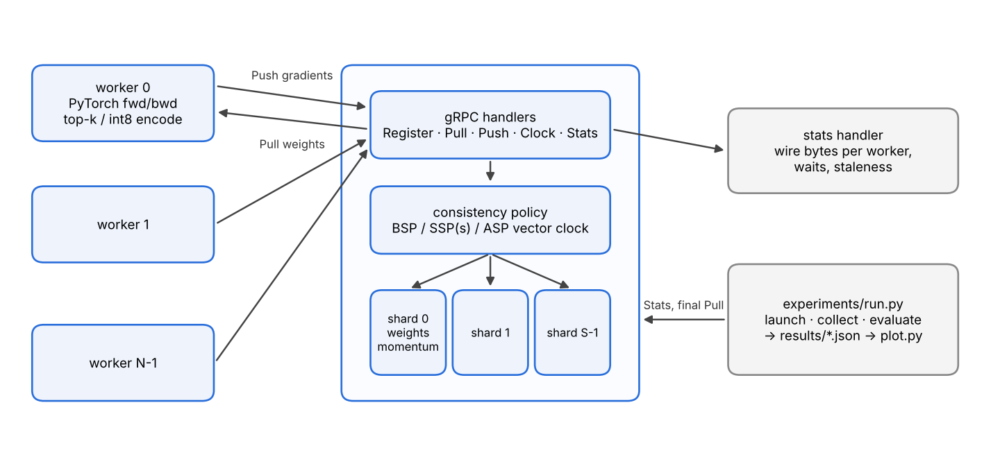

# MiniPS: a parameter-server training runtime in Go and PyTorch


A sharded parameter server in Go, with PyTorch workers talking to it over gRPC. The synchronisation rule (BSP, bounded staleness, asynchronous) and the gradient compression (none, top-k with error feedback, 8-bit) are each one config flag. Every experiment is one command, and every figure is regenerated from `results/`. In a small-scale CPU run, bounded staleness (s = 4) with top-k compression cut measured bytes on the wire **7.0×** against a dense synchronous parameter server. At that training length, though, the staleness and sparsification cost a lot of accuracy, so read the findings before quoting it.

> **Status.** The full experiment behind the CV claim is configured in `experiments/configs/full/` and runs with `make reproduce`. It uses ResNet-18 on all of CIFAR-10 with 8 workers, 30 epochs and 3 seeds. **It has not been run yet.** It needs a GPU machine: one run takes about 7 hours on the 2-core CPU box where this repo was built, and the matrix is 63 runs. Every number on this page comes from the small-scale matrix described below and should be quoted as such.

## Results (small-scale matrix)

| run | seeds | test acc | Δ acc vs BSP dense | wall-clock (s) | speed-up | bytes on the wire (MiB) | comm. reduction | mean wait / worker (s) |
|---|---:|---:|---:|---:|---:|---:|---:|---:|
| allreduce | 1 | 0.6320 | +2.94 pp | 334 | 0.95× | 5,009* | 1.3× | n/a |
| allreduce_straggler | 1 | 0.6320 | +2.94 pp | 333 | 0.96× | 5,009* | 1.3× | n/a |
| asp_int8 | 1 | 0.4295 | -17.31 pp | 323 | 0.99× | 4,180 | 1.6× | 0.0 |
| asp_none | 1 | 0.4644 | -13.82 pp | 361 | 0.88× | 6,684 | 1.0× | 0.0 |
| asp_topk | 1 | 0.3281 | -27.45 pp | 345 | 0.92× | 3,395 | 2.0× | 0.0 |
| bsp_int8 | 1 | 0.6340 | +3.14 pp | 318 | 1.00× | 4,180 | 1.6× | 8.8 |
| bsp_none | 1 | 0.6026 | +0.00 pp | 319 | 1.00× | 6,684 | 1.0× | 8.9 |
| bsp_none_straggler | 1 | 0.6268 | +2.42 pp | 337 | 0.95× | 6,684 | 1.0× | 53.2 |
| bsp_topk | 1 | 0.3417 | -26.09 pp | 328 | 0.97× | 3,395 | 2.0× | 9.5 |
| bsp_topk_mc | 1 | 0.3829 | -21.97 pp | 324 | 0.98× | 3,395 | 2.0× | 8.6 |
| bsp_topk_noef | 1 | 0.5361 | -6.65 pp | 319 | 1.00× | 3,395 | 2.0× | 8.0 |
| bsp_topk_straggler | 1 | 0.3417 | -26.09 pp | 338 | 0.94× | 3,395 | 2.0× | 53.7 |
| ssp2_int8 | 1 | 0.3218 | -28.08 pp | 322 | 0.99× | 2,685 | 2.5× | 0.0 |
| ssp2_none | 1 | 0.3814 | -22.12 pp | 321 | 0.99× | 5,064 | 1.3× | 0.0 |
| ssp2_topk | 1 | 0.2483 | -35.43 pp | 321 | 0.99× | 1,730 | 3.9× | 0.0 |
| ssp2_topk_straggler | 1 | 0.4091 | -19.35 pp | 343 | 0.93× | 2,817 | 2.4× | 52.1 |
| ssp4_int8 | 1 | 0.2468 | -35.58 pp | 311 | 1.02× | 1,721 | 3.9× | 0.0 |
| ssp4_none | 1 | 0.1317 | -47.09 pp | 313 | 1.02× | 4,215 | 1.6× | 0.0 |
| ssp4_topk | 1 | 0.1024 | -50.02 pp | 312 | 1.02× | 961 | 7.0× | 0.0 |
| ssp4_topk_mc | 1 | 0.1997 | -40.29 pp | 309 | 1.03× | 1,020 | 6.6× | 0.0 |
| ssp4_topk_straggler | 1 | 0.3557 | -24.69 pp | 344 | 0.93× | 2,677 | 2.5× | 50.3 |

\* All-reduce bytes are computed from DDP bucket sizes (ring: 2(N−1)/N per rank), not measured.

Setup: ResNet-18 at width 16 (0.70M parameters) on a fixed 20,000-image subset of CIFAR-10, with 4 workers, batch 128 per worker, 8 epochs and lr 0.4. The schedule is 1 warm-up epoch, then cosine. Momentum is 0.9 and weight decay 5e-4. There is 1 seed per configuration. The hardware was an Intel Xeon @ 2.10 GHz cloud VM with 2 vCPUs and 8 GB RAM (6 GB usable), running PyTorch 2.15 on CPU and Go 1.24, with one PyTorch thread per worker and all processes on the same machine. "Bytes on the wire" is the sum of gRPC payload bytes in both directions, counted by a stats handler on the server. For the all-reduce baseline it is the ring all-reduce traffic computed from DDP bucket sizes. Communication reduction and speed-up are measured against `bsp_none`, the dense synchronous parameter server. Accuracy is on the full 10,000-image test set after recomputing BatchNorm statistics.

The CIFAR-10 images came from a JPEG mirror on GitHub (YoongiKim/CIFAR-10-images), because this machine could not reach the official host. JPEG re-encoding is slightly lossy, so absolute accuracies are not comparable to published CIFAR-10 numbers. The full matrix uses the official dataset through torchvision.


### What the small-scale matrix shows

**The noise floor is about 3 points.** `bsp_none` and `bsp_none_straggler` run the same synchronous algorithm and differ only in the order floating-point sums arrive. They finish 2.4 points apart. Each configuration has one seed, so treat smaller differences as noise.

**Bytes.** Top-k at 1% shrinks pushes 63× (3,342 → 53 MiB, measured), and int8 shrinks them 4.0×. Pulls stay dense, though, and they are half of the dense traffic, so gradient compression alone tops out at 2.0× overall. The rest has to come from pulling less. SSP workers reuse cached weights and skip 48% of pulls at s = 2 and 74% at s = 4. SSP s = 4 with top-k reaches **7.0×** (6,684 → 961 MiB). Reaching 12× would need savings on the pull side too, for example sparsified weight deltas. MiniPS does not do that yet.

**Accuracy.** At 8 epochs (312 steps), almost every departure from dense BSP cost far more accuracy than the noise floor. This setup does **not** support a claim of "under 0.5% accuracy loss" for bounded staleness with top-k. The likely causes, each a hypothesis for the full-scale run to test:
* **Top-k at 1% for only 312 steps** means each weight is updated about 3 times on average. Error feedback piles up large stale residuals, and server-side momentum amplifies them when they are finally sent. Here plain top-k *without* error feedback (−6.7 pp) beat top-k with it (−26 pp). DGC-style momentum correction (`*_topk_mc`) recovered only part of the gap (−22 pp). Deep Gradient Compression also warms sparsity up over the first epochs, and that is the next thing to add.
* **Staleness with momentum 0.9 at learning rate 0.4.** SSP with s = 4 stalls near chance (13%), and s = 2 reaches 38%. ASP reaches 46% because it pulls every step and so reads *fresher* weights than SSP's cache. Asynchrony behaves like extra momentum, so SSP and ASP need a lower momentum or learning rate than BSP, and this matrix used one setting for all of them. SSP workers also do not apply their own updates to their cache.

**Wall-clock.** Every run finished within 5% of dense BSP. Four workers shared two cores and talked over loopback, so training was compute-bound: communication was cheap, and a worker waiting at a barrier simply freed a core for the others. SSP removed barrier waiting (mean wait 8.9 s → 0), but on this machine waiting was not lost time. For the same reason the straggler barely mattered (BSP +6%, all-reduce +0%): a sleeping worker hands its core to the rest. Measuring a speed-up needs one core or GPU per worker and a real network between machines.

**Baseline check.** Dense BSP on the parameter server and DDP all-reduce are the same algorithm. On the tiny MLP config both reach 98.44% test accuracy. Here they reach 60.3% and 63.2%, within the noise floor.

## Architecture



The Go server holds the weights, sharded by a hash of the tensor name, and runs SGD with momentum when a gradient arrives. Workers pull weights, run forward and backward passes, push gradients and report the end of each iteration. The [design notes](docs/design.md) cover the wire format, the shard goroutines and the vector clock.

## Quickstart

```bash
git clone https://github.com/teim/minips && cd minips
pip install --extra-index-url https://download.pytorch.org/whl/cpu -r requirements.txt   # Go 1.22+ also needed
make build                     # builds bin/ps-server
./launch/local.sh              # 2 workers train a small MLP on synthetic data, ~10 s
./launch/local.sh experiments/configs/smoke/ssp4_topk.yaml   # one small-scale run, ~6 min on 2 CPU cores
```

## Reproduce the results

```bash
make smoke       # the small-scale matrix above: 21 runs, ~2.3 h on 2 CPU cores
make reproduce   # the full matrix: 21 configurations x 3 seeds, ResNet-18 / CIFAR-10 / 8 workers / 30 epochs
make test        # go test -race, pytest (codec round trips, two-worker integration runs)
```

`experiments/sweep.py` skips runs whose result file already exists, so an interrupted sweep resumes where it stopped. Each result JSON records the git commit, the full config, the hardware and every per-worker counter. `experiments/plot.py` rebuilds every table and figure from those files.

## Design decisions

**Why a parameter server and not all-reduce?** All-reduce is the better default when workers run at the same speed on a fast interconnect. It has no central bottleneck, and NCCL rings saturate the links. A parameter server earns its place in three situations. Workers can run at different speeds, and bounded staleness lets fast workers keep going instead of waiting at a barrier every step. Bandwidth can be the bottleneck, so compressed pushes and skipped pulls cut traffic. Or you need asynchrony at all. The straggler experiment above shows the first case on this hardware. On a single machine the "network" is loopback, so the second case shows up in bytes rather than in wall-clock.

**Optimiser state lives on the server.** Workers send gradients, never weights. Momentum and weight decay are applied on the shard that owns the tensor, so there is one copy of optimiser state and pushing a compressed gradient is enough.

**One goroutine per shard, no locks on the update path.** Each shard owns its tensors and receives updates on a channel. Decoding a push, which is the expensive part for top-k and int8, happens in the gRPC handler goroutine, so it runs in parallel across workers. The only lock guards the vector clock, which is a few integers.

**SSP is enforced on both sides.** The server blocks a read at clock `c` until `c − min(done) ≤ s`. Each pull also returns `min(done)`, and a worker reuses its cached weights while that bound still holds, so most SSP iterations skip the pull entirely. Pull traffic is half the dense total, so this is where most of SSP's byte saving comes from. Top-k only shrinks pushes.

**Error feedback with top-k.** Whatever top-k does not send stays in a residual and is added to the next gradient. That includes the dropped 99% and the float16 rounding of the 1% that was sent. Nothing is lost, only delayed. The `bsp_topk_noef` run keeps the same sparsity without the residual, to show the difference.

**Count wire bytes, not tensor sizes.** A gRPC stats handler adds the `WireLength` of every message to the counters of the worker named in the request header. The communication-reduction column is therefore measured, including chunk headers and tensor names, not computed from `k`.

**Tensors as raw bytes.** Each chunk is a name, an encoding tag and little-endian bytes. Messages are at most 4 MiB, so large layers never reach gRPC's size limits. `repeated float` would make protobuf encode each element separately.

**What happens if a worker dies?** It is not handled. Under BSP the server waits for that worker's `Clock` forever. Under SSP the other workers stop once they are `s` clocks ahead. Fixing this needs heartbeats, a timeout that removes the worker from the vector clock, and server checkpoints so the worker can rejoin.

## Limitations and next steps

* **The full-scale matrix has not been run.** That needs a GPU or a multi-machine CPU cluster.
* **Small-scale runs use 1 seed.** Differences of a percentage point or two in accuracy are within run-to-run noise.
* **Everything ran on one machine.** All processes shared 2 cores over loopback, so compression saves bytes but not time. Measuring the wall-clock effect needs real network links between machines.
* **No failure handling:** see above.
* **BatchNorm statistics are local to each worker** and are recomputed for evaluation.
* **SSP workers do not apply their own updates to their cached weights** between pulls. Systems like Bösen do, which reduces effective staleness.
* **No server checkpointing.** Other stretch goals not started: worker rejoin, a ring all-reduce in Go, multi-machine runs.

## Layout

```
proto/ps.proto              gRPC service and messages
server/                     Go module: cmd/ps-server, internal/{shard,consistency,codec,metrics,server,params,pb}
worker/minips/              client, compression, models, data, training loop, evaluation, init file writer
baselines/allreduce.py      torch.distributed DDP baseline with the same model, data and schedule
experiments/                configs/{smoke,full}/*.yaml, make_configs.py, run.py, sweep.py, plot.py
launch/local.sh             server + N workers on one machine
results/                    one JSON per run, tables and figures
tests/                      pytest; Go tests live next to the code
```

MIT licence.
